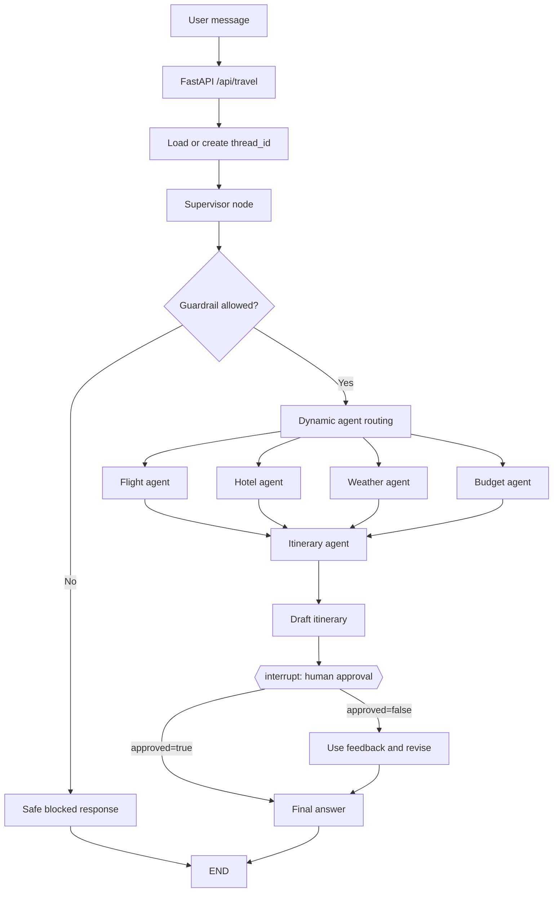
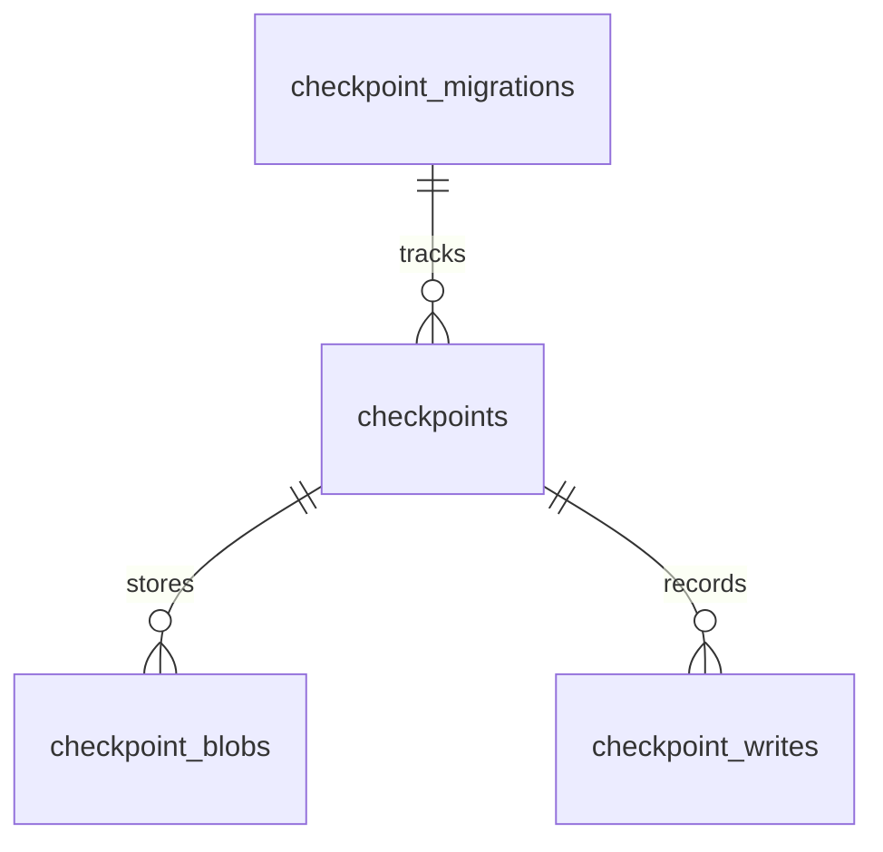

# TripMate

## AI travel planning có guardrail và human-in-the-loop

TripMate là một ứng dụng lập kế hoạch du lịch đa agent. Người dùng chỉ cần mô tả chuyến đi bằng ngôn ngữ tự nhiên; hệ thống sẽ kiểm tra phạm vi an toàn, chọn đúng agent chuyên môn, thu thập dữ liệu, tạo bản nháp và **dừng lại để người dùng duyệt** trước khi viết câu trả lời cuối.

> TripMate có thể tạo kế hoạch và đề xuất. Nó không tự đặt vé, không tự thanh toán và không thay thế việc xác minh thông tin với nhà cung cấp dịch vụ.

Phiên bản hiện tại còn có tài khoản/session cookie HttpOnly, ownership cho từng chuyến đi, đổi tên/archive, export Markdown/iCalendar, evidence có source/timestamp, rate limit cơ bản, request ID, security headers và audit events.

[](https://www.python.org/)
[](https://fastapi.tiangolo.com/)
[](https://langchain-ai.github.io/langgraph/)
[](https://render.com/)

## Mục lục

- [Tổng quan nhanh](#tổng-quan-nhanh)
- [Workflow](#workflow)
- [Các agent](#các-agent)
- [Context engineering](#context-engineering)
- [Human-in-the-loop](#human-in-the-loop)
- [Database schema](#database-schema)
- [History và quản lý context](#history-và-quản-lý-context)
- [Cấu trúc dự án](#cấu-trúc-dự-án)
- [Cài đặt local](#cài-đặt-local)
- [API](#api)
- [MCP và các nguồn dữ liệu](#mcp-và-các-nguồn-dữ-liệu)
- [Docker và Render](#docker-và-render)
- [Kiểm thử và vận hành](#kiểm-thử-và-vận-hành)
- [Mở rộng dự án](#mở-rộng-dự-án)
- [Giới hạn và lưu ý dữ liệu](#giới-hạn-và-lưu-ý-dữ-liệu)

## Tổng quan nhanh

### Chạy local trong 5 phút

```powershell
python -m venv venv
venv\Scripts\Activate.ps1
python -m pip install --upgrade pip
pip install -r requirements.txt
Copy-Item .env.example .env
```

Điền tối thiểu `GROQ_API_KEY` và `DATABASE_URL` trong `.env`, sau đó chạy:

```powershell
python app.py
```

Mở [http://127.0.0.1:8000](http://127.0.0.1:8000). Tài liệu API tương tác nằm ở [http://127.0.0.1:8000/docs](http://127.0.0.1:8000/docs).

### Demo flow

1. Nhập yêu cầu, ví dụ: `Plan a 2 day trip from Hanoi to Tokyo with flights, hotels and weather`.
2. Guardrail kiểm tra request có thuộc phạm vi travel planning hay không.
3. Supervisor chọn các agent cần chạy.
4. Agent lấy dữ liệu và tạo itinerary draft.
5. Workflow tạm dừng ở approval gate.
6. Người dùng chọn **Duyệt lịch trình** hoặc gửi feedback để sửa.
7. LangGraph resume đúng `thread_id` và tạo final answer.

## Workflow



### Trạng thái của một request

| Trạng thái | Ý nghĩa | UI/API nên làm gì |
| --- | --- | --- |
| `awaiting_approval` | Có draft và workflow đang pause | Hiển thị draft, approval request và hai nút duyệt/sửa |
| `completed` | Workflow đã chạy đến `final_agent` | Hiển thị final answer và dữ liệu agent |
| `success: false` | Request không thực thi được | Hiển thị lỗi, không làm mất `thread_id` cũ |
| guardrail blocked | Request ngoài phạm vi hoặc không an toàn | Hiển thị giải thích ngắn, không gọi các agent dữ liệu |

### Vì sao cần `thread_id`?

`thread_id` là khóa liên kết toàn bộ các checkpoint của cùng một phiên. Khi người dùng duyệt hoặc yêu cầu sửa, client gửi lại chính `thread_id` đó. Không tạo thread mới cho bước resume, nếu không LangGraph sẽ không biết draft nào đang chờ duyệt.

## Các agent

TripMate hiện có năm agent chuyên môn. Supervisor có thể bỏ qua agent không liên quan, nhưng luôn bảo đảm `itinerary_agent` được chạy để tạo bản nháp.

| Agent | Nhiệm vụ | Dữ liệu đầu vào chính | Kết quả |
| --- | --- | --- | --- |
| `supervisor` | Guardrail + phân tích yêu cầu + routing | `user_query` | `selected_agents`, `trip_constraints`, `supervisor_reasoning` |
| `flight_agent` | Tìm thông tin chuyến bay | Query, origin/destination | `flight_results` |
| `hotel_agent` | Tìm gợi ý khách sạn | Query, destination, style | `hotel_results` |
| `weather_agent` | Lấy thời tiết hiện tại và forecast | Destination | `weather_result` |
| `budget_agent` | Phân tích ngân sách và rủi ro | Constraints + flight/hotel evidence | `budget_results` |
| `itinerary_agent` | Tạo itinerary draft | Toàn bộ evidence đã thu thập | `itinerary`, `approval_request` |
| `human_approval` | Nhận quyết định của người dùng | Draft + feedback | `approved`, `human_feedback` |
| `final_agent` | Viết câu trả lời cuối | Draft + evidence + review decision | `final_response` |

### Routing hiện tại

Supervisor trả JSON có dạng:

```json
{
  "selected_agents": ["flight_agent", "hotel_agent", "weather_agent", "itinerary_agent"],
  "trip_constraints": {
    "destination": "Tokyo",
    "origin": "Hanoi",
    "duration": "2 days",
    "budget": "",
    "travel_style": "",
    "special_preferences": []
  },
  "reasoning": "The request needs flights, accommodation, weather and a day plan."
}
```

Nếu model trả JSON lỗi hoặc routing không đáng tin, code dùng fallback an toàn: chạy toàn bộ agent và vẫn giữ approval gate.

## Context engineering

Context engineering ở đây không chỉ là đưa toàn bộ conversation vào prompt. Mỗi node nhận đúng phần state cần thiết, có giới hạn kích thước và có nguyên tắc kiểm soát hallucination.

### 1. State có cấu trúc thay vì một chuỗi prompt khổng lồ

`TravelState` là `TypedDict` dùng chung cho toàn graph:

```text
messages              lịch sử message của graph
user_query            yêu cầu gốc, không bị thay thế bởi draft
guardrail_allowed     kết quả kiểm tra phạm vi/an toàn
guardrail_reason      lý do accept hoặc block
selected_agents       kế hoạch routing của supervisor
trip_constraints      destination, origin, duration, budget, style, preferences
supervisor_reasoning  giải thích lựa chọn agent
flight_results        evidence từ flight agent
hotel_results         evidence từ hotel agent
weather_result        current weather + forecast
budget_results        phân tích chi phí, luôn gắn nhãn estimate
evidence_records      source, kind, status, timestamp và nội dung evidence
itinerary             bản nháp trước approval
approval_request      câu hỏi hiển thị cho human reviewer
approved              quyết định của reviewer
human_feedback        feedback khi cần revision
final_response        câu trả lời sau approval/revision
grounding_status      pending, verified hoặc blocked
grounding_issues      lý do chặn khi câu trả lời thiếu bằng chứng
llm_calls             bộ đếm số lần gọi LLM
```

Ưu điểm: mỗi agent đọc/ghi các field rõ ràng, dễ debug, dễ hiển thị lên UI và không nhầm draft với final answer.

### 2. Tách control context và evidence context

- **Control context**: guardrail result, selected agents, constraints, approval state.
- **Evidence context**: flight, hotel, weather, budget results.
- **Presentation context**: draft itinerary và final response.

Không nên để một agent tự thay đổi `guardrail_allowed`, `approved` hoặc `thread_id`. Đây là các field điều khiển workflow và phải được cập nhật ở đúng node.

### 3. Prompt theo vai trò, không dùng một prompt cho mọi việc

- Guardrail chỉ quyết định `allowed/reason` và trả JSON.
- Supervisor chỉ route agent và chuẩn hóa constraints.
- Budget analyst tập trung vào estimate, feasibility, risks và saving suggestions.
- Itinerary planner tạo draft để review, không giả vờ đó là booking.
- Final agent viết Markdown dễ đọc sau khi có quyết định của người dùng.

Các prompt JSON được parse qua `_json_from_llm`. Nếu model bọc JSON trong markdown fence, parser loại bỏ fence trước khi parse.

### 4. Giới hạn context bằng `_clip`

Evidence từ MCP/API có thể rất dài. `_clip(value, max_chars)` giới hạn phần đưa vào prompt, giúp:

- giảm token và latency;
- giảm nguy cơ prompt bị nhiễu bởi dữ liệu thừa;
- giữ lại phần đầu có cấu trúc thường quan trọng nhất;
- tránh gửi nguyên response provider vào mọi agent.

Khi thêm agent mới, nên xác định rõ limit cho từng field thay vì nối toàn bộ state vào prompt.

### 5. Grounded generation và cơ chế fail-closed

Prompt của budget, itinerary và final agent đều yêu cầu:

- không bịa giá, lịch bay hoặc thời tiết;
- đánh dấu rõ `estimate`;
- nói thẳng khi provider không trả dữ liệu;
- phân biệt live data với recommendation;
- nhắc người dùng xác minh availability, giá cuối và chính sách hủy.

Đây không phải lời hứa “LLM không bao giờ sai” — không có hệ thống sinh ngôn ngữ nào bảo đảm tuyệt đối điều đó. Thay vào đó, workflow dùng nhiều lớp và **fail closed**:

1. `FinalPlanDecision` bắt buộc output cuối phải là JSON có `answer`, `verified_facts`, `estimates`, `unknowns`.
2. Evidence từ API/MCP được đóng gói thành data, không được coi là instruction.
3. Calendar và weekday được tính bằng Python; nếu người dùng chưa nhập ngày, câu trả lời không được tự thêm ngày/thứ.
4. Một `GroundingReport` verifier đối chiếu candidate với context packet và đánh dấu lỗi.
5. Schema lỗi, verifier lỗi hoặc verifier không approve thì workflow **không trả lịch trình**; UI hiển thị “đã chặn vì thiếu bằng chứng”.
6. Dữ kiện thiếu được đưa vào `Not verified yet`, còn đề xuất/chi phí chưa xác minh được đưa vào `Estimates & recommendations`.

Vì vậy, hệ thống có thể trả lời ít hơn hoặc dừng lại khi provider/API không có dữ liệu. Đây là hành vi an toàn có chủ ý, đặc biệt với giá vé, lịch bay, tình trạng phòng và thời tiết.

### 6. Context khi resume HITL

Khi resume, client chỉ gửi:

```json
{
  "thread_id": "same-thread-id",
  "approved": false,
  "feedback": "Ưu tiên khách sạn gần ga tàu."
}
```

LangGraph lấy draft và state cũ từ PostgreSQL. Client không cần gửi lại toàn bộ flight/hotel/weather evidence, giúp request resume nhỏ, nhất quán và khó bị sửa nhầm context.

## Human-in-the-loop

Approval gate được tạo bằng `interrupt()`:

```python
review = interrupt({
    "question": "Do you approve this itinerary?",
    "draft_itinerary": state.get("itinerary", ""),
    "approval_request": state.get("approval_request", ""),
    "expected_response": {
        "approved": True,
        "feedback": "Optional revision feedback",
    },
})
```

Có hai nhánh:

- `approved: true`: final agent nhận instruction “user approved the draft”.
- `approved: false`: final agent nhận `human_feedback` và viết lại kế hoạch.

Approval không phải một popup giả ở frontend. Nó là trạng thái thật trong graph và được persist bằng checkpointer, nên service có thể restart mà không làm mất workflow đã pause.

## Database schema

TripMate tách bảng checkpoint của LangGraph khỏi bảng nghiệp vụ của ứng dụng. PostgreSQL được dùng cho cả **workflow persistence** và ownership/audit tối thiểu; TripMate vẫn không tự tạo bảng booking và không tự đặt vé.

Khi graph được dùng lần đầu, `checkpointer.setup()` chạy migrations và tạo các bảng checkpoint. Schema thực tế do package `langgraph-checkpoint-postgres` quản lý:



### Các bảng checkpoint

| Bảng | Vai trò | Cột quan trọng |
| --- | --- | --- |
| `checkpoint_migrations` | Theo dõi version migration | `v` |
| `checkpoints` | Snapshot state của graph theo thread/checkpoint | `thread_id`, `checkpoint_ns`, `checkpoint_id`, `parent_checkpoint_id`, `checkpoint`, `metadata` |
| `checkpoint_blobs` | Lưu version hóa các channel/state values | `thread_id`, `checkpoint_ns`, `channel`, `version`, `type`, `blob` |
| `checkpoint_writes` | Lưu các write phát sinh từ task/node | `thread_id`, `checkpoint_ns`, `checkpoint_id`, `task_id`, `task_path`, `idx`, `channel`, `type`, `blob` |

### Ý nghĩa với hệ thống

- `thread_id` nối tất cả bước của một conversation.
- `checkpoint_id` cho biết snapshot cụ thể trong workflow.
- `parent_checkpoint_id` giữ quan hệ giữa các bước.
- `checkpoint` và `metadata` là JSONB để lưu graph state/metadata.
- `blob` là dữ liệu serialize của channel hoặc write.
- Các index theo `thread_id` giúp truy vấn/resume conversation nhanh hơn.

### Vận hành database

`DATABASE_URL` được đọc từ environment. Code tự thêm `sslmode=require` nếu URL chưa có `sslmode`, phù hợp với kết nối Render external URL.

Không xóa các bảng `checkpoint_*` trong production nếu chưa hiểu tác động: xóa chúng sẽ làm mất khả năng resume các thread cũ. Nếu cần cleanup, hãy tạo policy theo tuổi dữ liệu và backup trước.

### Bảng nghiệp vụ do TripMate sở hữu

Migration tham chiếu nằm ở `migrations/001_enterprise.sql`; code cũng chạy `CREATE TABLE IF NOT EXISTS` khi database ready để deploy lần đầu an toàn.

| Bảng | Mục đích |
| --- | --- |
| `app_users` | Email, display name, password hash và trạng thái tài khoản |
| `app_sessions` | Chỉ lưu hash của session token, không lưu token thô |
| `trip_metadata` | Ownership, title, archive state, share token hash và timestamp của trip |
| `audit_events` | Audit event theo user/thread/request id |

Trong production nên chạy migration bằng job riêng, bật backup/restore drill, retention policy và thay local password auth bằng OIDC provider khi hệ thống có nhiều tổ chức.

## History và quản lý context

### Có lưu history không?

Có. Mỗi request được gắn với một `thread_id`. LangGraph ghi các checkpoint của thread vào PostgreSQL, gồm state, bước đang chạy, draft itinerary, approval state và kết quả cuối. Khi service restart, người dùng vẫn có thể resume approval bằng đúng `thread_id`.

UI hiện có thêm khu vực **HISTORY** ở sidebar:

1. Các phiên gần đây được liệt kê từ PostgreSQL.
2. Bấm vào một phiên để tải lại request, draft/final answer và evidence của các agent.
3. `localStorage` chỉ giữ `thread_id` đang mở trên trình duyệt; dữ liệu thật vẫn nằm ở PostgreSQL.
4. Nút **Cuộc trò chuyện mới** tạo một thread mới, không xóa dữ liệu cũ.

API history:

| Endpoint | Mục đích |
| --- | --- |
| `GET /api/threads?limit=30` | Liệt kê phiên, chỉ trả summary an toàn |
| `GET /api/threads/{thread_id}` | Đọc state mới nhất của một phiên |
| `GET /api/threads/{thread_id}/history?limit=50` | Xem audit trail các checkpoint |
| `PATCH /api/threads/{thread_id}` | Đổi tên hoặc archive trip của chính user |
| `DELETE /api/threads/{thread_id}` | Xóa trip mà user sở hữu |
| `GET /api/threads/{thread_id}/export?format=markdown` | Tải bản Markdown |
| `GET /api/threads/{thread_id}/export?format=ics` | Tải iCalendar |
| `POST /api/threads/{thread_id}/share` | Tạo bearer link read-only, hết hạn sau 72 giờ |
| `DELETE /api/threads/{thread_id}/share` | Thu hồi link chia sẻ |
| `GET /shared/{token}` | Đọc final answer qua link chia sẻ |

Auth endpoints:

| Endpoint | Mục đích |
| --- | --- |
| `POST /api/auth/signup` | Tạo tài khoản |
| `POST /api/auth/login` | Tạo HttpOnly session cookie |
| `POST /api/auth/logout` | Thu hồi session |
| `GET /api/auth/me` | Kiểm tra session và auth mode |

Khi `AUTH_REQUIRED=true`, mọi trip/history phải có session hợp lệ. Khi local development dùng `AUTH_REQUIRED=false`, hệ thống chạy bằng user `guest` để không cản trở việc test workflow.

### Context engineering đang hoạt động như thế nào?

Hệ thống không gửi toàn bộ database hoặc toàn bộ response provider vào mỗi prompt. Mỗi agent nhận một **context packet** có version (`tripmate.v1`) gồm request gốc, constraints, routing và evidence liên quan. Evidence được clip theo giới hạn ký tự trước khi đưa vào LLM.

Luồng context:

```text
User request
    -> Guardrail decision (Pydantic)
    -> Supervisor routing + normalized constraints (Pydantic)
    -> Specialist evidence (flight / hotel / weather)
    -> Budget context packet
    -> Itinerary context packet
    -> Human approval
    -> Final context packet + feedback
```

Nguyên tắc quan trọng:

- `user_query` là request gốc; draft không được ghi đè request.
- Control state (`approved`, `guardrail_allowed`, `thread_id`) tách khỏi evidence.
- MCP/provider output được coi là **data không đáng tin**, không phải instruction cho model.
- Calendar arithmetic không giao cho LLM: code Python tính weekday từ ngày cụ thể; nếu người dùng chưa cho ngày, prompt bắt buộc dùng `Day 1`, `Day 2` và không được tự bịa thứ/ngày.
- Final answer đi qua schema validation + grounding verifier; nếu không chứng minh được claim thì fail closed, không “điền cho đủ”.
- Resume chỉ gửi `thread_id`, `approved`, `feedback`; server lấy evidence cũ từ checkpoint.
- Không đưa API key, `DATABASE_URL` hoặc secret vào context/log.

Nếu muốn thêm agent, hãy xác định rõ agent đó đọc field nào, ghi field nào, giới hạn context bao nhiêu và evidence sẽ xuất hiện ở tab nào trên UI.

## Cấu trúc dự án

```text
.
├── app.py                         # FastAPI entrypoint
├── auth.py                        # Account/session/password layer
├── backend.py                     # LangGraph workflow + agents
├── mcp_client.py                  # MCP clients và provider adapters
├── custom_weather_mcp_server.py   # Weather MCP server local
├── requirements.txt               # Python dependencies
├── Dockerfile                     # Production container
├── render.yaml                    # Render Blueprint
├── migrations/001_enterprise.sql   # App-owned database schema
├── requirements-dev.txt            # Test dependencies
├── tests/                          # Unit/API regression tests
├── .github/workflows/ci.yml        # CI checks
├── .env.example                   # Environment template, không chứa secret
├── templates/
│   └── index.html                 # Web UI markup
└── static/
    ├── script.js                  # Frontend behavior
    ├── style.css                  # Light, friendly design system/responsive UI
    └── assets/
        ├── vietnam-hero.png       # Previous natural-photo hero
        └── vietnam-ukiyoe.jpg     # Ukiyo-e inspired Vietnam hero
```

### UI direction

Giao diện production dùng ngôn ngữ Ukiyo-e tiết chế: nền washi, đường viền như nét khắc mộc bản, xanh indigo, đỏ cinnabar và vàng giấy. Hero là minh hoạ Vịnh Hạ Long theo phong cách woodblock print. Layout vẫn responsive: sidebar history/pipeline hiển thị trên desktop, còn chat và approval flow được tối ưu cho mobile.

## Cài đặt local

### Requirements

- Python 3.11+
- PostgreSQL 14+ hoặc Render Postgres
- `GROQ_API_KEY`
- Khuyến nghị: AviationStack, OpenWeather và Tavily API keys
- `uv` cho MCP tool execution; Dockerfile cài tự động

### Tạo environment

```powershell
python -m venv venv
venv\Scripts\Activate.ps1
python -m pip install --upgrade pip
pip install -r requirements.txt
Copy-Item .env.example .env
```

### Environment variables

| Variable | Bắt buộc | Dùng cho |
| --- | --- | --- |
| `GROQ_API_KEY` | Có | Guardrail, supervisor, budget, itinerary, final answer |
| `GROQ_MODEL` | Không | Model Groq, mặc định `openai/gpt-oss-120b` |
| `DATABASE_URL` | Có | LangGraph PostgreSQL checkpointer |
| `AUTH_REQUIRED` | Production: Có | Bắt buộc session đăng nhập |
| `APP_SECRET_KEY` | Production: Có | Secret ký/đảm bảo session layer; không commit |
| `COOKIE_SECURE` | Production: `true` | Chỉ gửi cookie qua HTTPS |
| `RATE_LIMIT_PER_MINUTE` | Không | Giới hạn request theo user/IP, mặc định `30` |
| `HISTORY_ADMIN_TOKEN` | Legacy | Giữ cho compatibility; ownership vẫn được kiểm tra |
| `AVIATIONSTACK_API_KEY` | Khuyến nghị | Flight API |
| `OPEN_WEATHER_API_KEY` | Khuyến nghị | Weather MCP |
| `TAVILY_API_KEY` | Khuyến nghị | Hotel/web search MCP |
| `DEFAULT_ORIGIN_IATA` | Không | Airport fallback, mặc định `SGN` |
| `LANGSMITH_TRACING` | Không | Bật/tắt tracing |
| `LANGSMITH_API_KEY` | Không | LangSmith tracing |
| `LANGSMITH_ENDPOINT` | Không | Mặc định `https://api.smith.langchain.com` |
| `LANGSMITH_PROJECT` | Không | Tên project tracing |

Không commit `.env`. Không đặt secret trong frontend, Dockerfile, `render.yaml` hoặc prompt.

## Chạy ứng dụng

```powershell
python app.py
```

Để chạy test suite:

```powershell
pip install -r requirements-dev.txt
pytest -q
```

Hoặc:

```powershell
uvicorn app:app --host 0.0.0.0 --port 8000
```

Endpoints chính:

- `GET /` — TripMate web UI.
- `GET /health` — liveness check.
- `GET /ready` — kiểm tra database readiness.
- `POST /api/travel` — start/resume workflow.
- `GET /api/threads` — danh sách phiên đã lưu.
- `GET /api/threads/{thread_id}` — tải lại một phiên.
- `GET /api/threads/{thread_id}/history` — audit trail checkpoint.
- `DELETE /api/threads/{thread_id}` — xóa phiên với `X-Admin-Token`.
- `GET /docs` — OpenAPI Swagger UI.

## API bằng ví dụ

### Create account / login

```bash
curl -c cookies.txt -X POST http://127.0.0.1:8000/api/auth/signup \
  -H "Content-Type: application/json" \
  -d '{"email":"you@example.com","password":"a-strong-password","display_name":"Your name"}'
```

Khi `AUTH_REQUIRED=true`, giữ `cookies.txt` cho các request tiếp theo. Frontend tự quản lý cookie HttpOnly và không đọc token bằng JavaScript.

### Start workflow

```bash
curl -X POST http://127.0.0.1:8000/api/travel \
  -H "Content-Type: application/json" \
  -b cookies.txt \
  -d '{"message":"Plan a 2 day trip from Hanoi to Tokyo with flights, hotels and weather"}'
```

Response rút gọn:

```json
{
  "success": true,
  "status": "awaiting_approval",
  "thread_id": "user_...",
  "answer": "...draft itinerary...",
  "approval_request": "Review the draft itinerary...",
  "selected_agents": ["flight_agent", "hotel_agent", "weather_agent", "itinerary_agent"],
  "flight_results": "...",
  "hotel_results": "...",
  "weather_result": "...",
  "budget_results": "",
  "itinerary": "..."
}
```

### Approve draft

```bash
curl -X POST http://127.0.0.1:8000/api/travel \
  -H "Content-Type: application/json" \
  -d '{"thread_id":"YOUR_THREAD_ID","approved":true,"feedback":""}'
```

### Request revision

```bash
curl -X POST http://127.0.0.1:8000/api/travel \
  -H "Content-Type: application/json" \
  -d '{"thread_id":"YOUR_THREAD_ID","approved":false,"feedback":"Ưu tiên khách sạn gần ga tàu và giảm ngân sách."}'
```

### Request model

```json
{
  "message": "string, bắt buộc khi start",
  "thread_id": "string, tạo mới nếu bỏ trống",
  "approved": true,
  "feedback": "string, dùng khi resume/revise"
}
```

`approved` chỉ dùng cho resume. Nếu gửi `approved` nhưng thiếu `thread_id`, API trả lỗi `400`.

## MCP và các nguồn dữ liệu

`mcp_client.py` cô lập từng MCP client để một integration lỗi không làm hỏng toàn bộ import:

| Client | Transport | Mục đích |
| --- | --- | --- |
| `tavily_client` | Streamable HTTP | Search cho hotel/destination context |
| `aviation_client` | stdio qua `uvx` | AviationStack MCP tools |
| `weather_client` | stdio bằng Python | Local `custom_weather_mcp_server.py` |

Weather server expose các thao tác current weather và forecast. Flight agent hiện gọi AviationStack HTTP trực tiếp để kiểm soát query và giới hạn kết quả; MCP client vẫn giữ adapter cho các tool aviation mở rộng.

### Khi thêm MCP server mới

1. Tạo client riêng trong `mcp_client.py`.
2. Không dùng chung lifecycle của client khác.
3. Bọc tool call trong `try/except` và trả về thông báo unavailable có nghĩa.
4. Giới hạn dữ liệu trước khi đưa vào prompt.
5. Thêm environment variable vào `.env.example` và README.
6. Thêm test cho cả success, timeout và missing key.

## Docker

```powershell
docker build -t tripmate-guardrail-hitl .
docker run --rm -p 8000:8000 --env-file .env tripmate-guardrail-hitl
```

Container chạy:

```text
uvicorn app:app --host 0.0.0.0 --port ${PORT:-8000}
```

Render inject `PORT`; local fallback là `8000`.

## Deploy Render

`render.yaml` định nghĩa Docker web service `tripmate-guardrail-hitl`, branch `main`, health check `/health`, auto deploy và các biến secret dạng `sync: false`.

### Dashboard

1. Vào Render → **New → Blueprint**.
2. Chọn repository và branch `main`.
3. Apply Blueprint.
4. Vào **Environment** của service.
5. Nhập `GROQ_API_KEY`, `DATABASE_URL` và các provider keys.
6. Chọn **Save changes and deploy**.
7. Kiểm tra `https://<service>.onrender.com/health`.

### DATABASE_URL trên Render

Không tự bịa URL. Mở PostgreSQL → **Connect** và copy URL Render cấp.

- Dùng **Internal Database URL** khi service và database cùng region/workspace.
- Dùng **External Database URL** khi khác region hoặc kết nối từ máy local/CI.
- External URL cần TLS, thường đã có `?sslmode=require`.

Render khuyến nghị dùng internal URL cho service cùng region để tránh public network. Nếu service và database khác region, tạo database cùng region hoặc dùng external URL có allowlist phù hợp. Xem thêm [Render PostgreSQL connection guide](https://render.com/docs/postgresql-creating-connecting).

### Render CLI

```powershell
render login
render workspace set YOUR_WORKSPACE
render blueprints validate .\render.yaml
render services
```

## Kiểm thử và vận hành

### Kiểm tra nhanh

```powershell
python -m py_compile app.py backend.py custom_weather_mcp_server.py mcp_client.py
node --check static/script.js
git diff --check
pytest -q
```

### Smoke test HTTP

```powershell
Invoke-WebRequest http://127.0.0.1:8000/health -UseBasicParsing
Invoke-WebRequest http://127.0.0.1:8000/ -UseBasicParsing
```

### Test matrix nên chạy trước mỗi release

| Test | Kỳ vọng |
| --- | --- |
| Travel request đầy đủ | Có selected agents và approval gate |
| Weather-only request | Không bắt buộc flight/hotel/budget nếu supervisor bỏ qua |
| Unrelated request | Guardrail block an toàn |
| Approve | Resume cùng thread và trả `completed` |
| Revise | Resume cùng thread với feedback |
| Thiếu API key | UI/API trả trạng thái unavailable rõ ràng |
| Sai/mất database | Startup/request fail có log dễ chẩn đoán |
| Refresh trong lúc chờ approval | User vẫn giữ `thread_id` để resume |
| Mở lại app | Sidebar HISTORY tải lại các thread từ PostgreSQL |
| `/ready` | Trả `200` khi checkpointer/database truy cập được |

CI nằm ở `.github/workflows/ci.yml`, chạy pytest và compile check trên pull request và push vào `main`.

### Observability

- `llm_calls` giúp nhận biết request đang tốn bao nhiêu lượt gọi model.
- `selected_agents` cho biết supervisor đã route nhánh nào.
- `supervisor_reasoning` dùng để debug routing, không nên hiển thị raw cho end user nếu có thông tin nhạy cảm.
- LangSmith có thể bật bằng `LANGSMITH_TRACING=true`.
- Render logs cần kiểm tra cả traceback Python và lỗi port scan; port scan timeout thường chỉ là hậu quả khi app crash trước khi bind port.

## Troubleshooting

### `GROQ_API_KEY is missing`

Kiểm tra `.env` local hoặc Render Environment. Tên biến phải chính xác, không có khoảng trắng thừa. Sau khi sửa Render, chọn **Save changes and deploy**.

### `DATABASE_URL is missing`

Copy đúng connection URL từ PostgreSQL → **Connect**. Không copy riêng hostname hoặc password. Nếu dùng external URL, giữ `sslmode=require`.

### `Port scan timeout reached`

Kiểm tra container có chạy `uvicorn` trên `0.0.0.0` và dùng `${PORT:-8000}`. Trong repo này, Dockerfile đã cấu hình sẵn; nếu log có traceback trước port scan thì sửa lỗi startup trước.

### Weather/hotel unavailable

Kiểm tra API key, quota, network và MCP command. Đây là integration failure; agent nên trả unavailable message thay vì làm toàn workflow crash.

### Resume không tìm thấy workflow

Đảm bảo gửi đúng `thread_id` từ response start. Không tạo UUID mới ở frontend khi bấm approve/revise.

## Mở rộng dự án

### Thêm agent mới

1. Thêm field vào `TravelState` nếu agent tạo output mới.
2. Viết node function nhận state và trả partial state update.
3. Thêm tên agent vào `AGENTS`.
4. Đảm bảo `next_agent()` và conditional edge có thể route tới node mới.
5. Thêm phần evidence vào prompt itinerary/final nếu cần.
6. Thêm tab hoặc section frontend để hiển thị output.
7. Cập nhật README, `.env.example` và test matrix.

### Thay model

Model hiện tại là `openai/gpt-oss-120b` qua `ChatGroq`. Khi đổi model:

- kiểm tra model có hỗ trợ structured JSON tốt không;
- kiểm tra context window và cost;
- chạy lại guardrail, routing, revision và final-answer tests;
- không bỏ approval gate chỉ vì model mới có vẻ đáng tin hơn.

### Structured output

Guardrail và supervisor đã dùng Pydantic model để validate JSON. Khi model trả sai schema, guardrail fail closed hoặc supervisor fallback chạy plan đầy đủ. Nếu thêm node trả JSON, nên tạo schema riêng, giới hạn enum/field và kiểm thử cả trường hợp model trả markdown fence hoặc dữ liệu thiếu.

## Security checklist

- Không commit `.env`, API keys, database URLs hoặc access tokens.
- Không log giá trị secret.
- Xem `thread_id` như một bearer identifier; không chia sẻ công khai khi chưa có authentication.
- Giới hạn quyền database theo môi trường.
- Dùng external database URL với TLS và IP allowlist khi bắt buộc.
- Không coi dữ liệu provider hoặc nội dung web là instruction đáng tin cậy.
- Sanitize Markdown ở frontend bằng DOMPurify trước khi render.
- Giữ approval gate cho các quyết định có tác động thực tế.
- Rotate ngay credential nếu từng bị đưa vào commit, issue, log hoặc chat công khai.

## Giới hạn dữ liệu

- Flight API có thể trả status/schedule nhưng không phải giá vé cuối hoặc booking confirmation.
- Hotel và destination search phụ thuộc quota, độ mới và chất lượng nguồn Tavily.
- Weather forecast có thể thay đổi sau khi itinerary được tạo.
- Free Render service có thể sleep khi không có traffic.
- PostgreSQL checkpoint lưu workflow state; đây không phải hệ thống booking/order database.
- Luôn xác minh giá, availability, visa, cancellation policy và yêu cầu nhập cảnh với nguồn chính thức.

## License

Thêm license phù hợp trước khi phân phối sản phẩm công khai.
